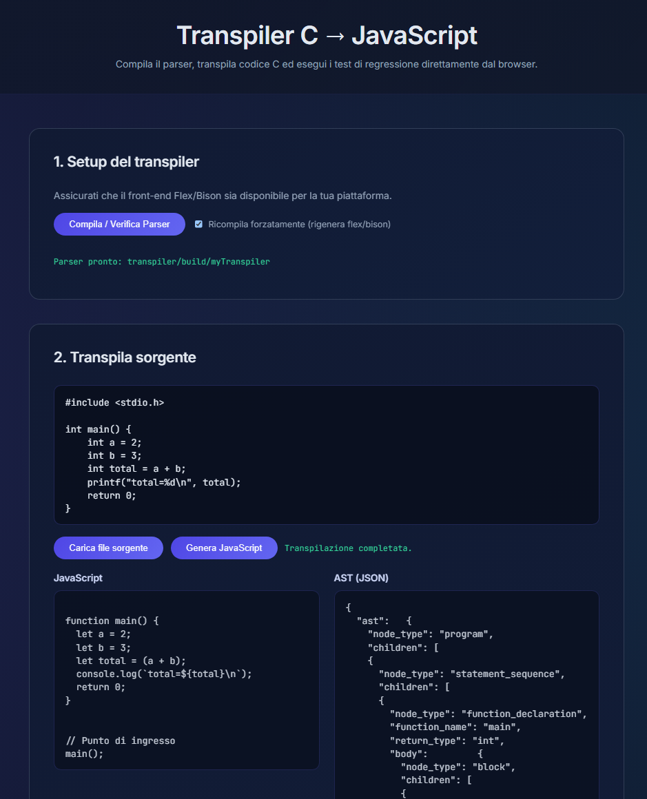

# C to JavaScript Transpiler

[](https://github.com/BartoloMorgigno11/C-to-JavaScript-Transpiler/actions/workflows/ci.yml)

An experimental compiler pipeline that translates a defined subset of C into JavaScript. The project combines a Flex scanner, Bison parser, C-based AST and semantic checks, Python code generation, regression tests, and a local Flask interface.

> This is an educational compiler project, not a full ISO C implementation. It accepts only the language constructs covered by its grammar and semantic rules.

**Project authorship:** Collaborative project by Bartolo Morgigno and Vito Marzocca. Development responsibilities were shared equally among team members, without a formal division of components.

## Web interface

<p align="center">
  
</p>

The local interface compiles the parser, transpiles a supported C program, and exposes both the generated JavaScript and the AST used by the Python backend.

## Highlights

- Scanner built with Flex and parser built with Bison.
- Abstract syntax tree, symbol table, and type-checking stages implemented in C.
- Python backend that converts the generated AST into JavaScript.
- CLI for build and transpilation.
- Regression suite with valid and invalid C programs.
- Local web interface for building, transpiling, inspecting the AST, and running the test suites.

## Requirements

- Linux, macOS, or WSL with Python 3.10+.
- Flex 2.6+, Bison 3.8+, and a C11 compiler such as GCC or Clang.
- Flask for the optional local web interface.

On Ubuntu/WSL:

```bash
sudo apt update
sudo apt install -y build-essential flex bison python3 python3-venv
```

## Quick start

```bash
python3 -m venv .venv
source .venv/bin/activate
python -m pip install -r requirements.txt
python scripts/run_tests.py --rebuild
```

The test command rebuilds the scanner/parser and runs three valid-input and three invalid-input regression cases.

## Transpile a C source file

```bash
python scripts/c_to_js.py transpiler/input/input.c \
  --output transpiler/output/output.js \
  --keep-ast
```

This creates the JavaScript output and, with `--keep-ast`, an adjacent JSON representation of the AST.

## Local web interface

```bash
python web/app.py
```

Open `http://127.0.0.1:5000`. Use only trusted local source files: this educational C parser is not hardened for untrusted input or public deployment. The interface remains local-only and can build the parser, transpile pasted C code, display generated JavaScript/AST, and show regression-test artefacts.

## Architecture

```text
C source
  -> Flex scanner + Bison parser
  -> AST / symbol table / type checks (C)
  -> AST JSON
  -> JavaScript code generation (Python)
```

- `transpiler/Front-end/` contains grammar, scanner, AST, and semantic analysis.
- `transpiler/Back-end/codegen.py` emits JavaScript from AST JSON.
- `scripts/` provides reproducible build, transpilation, and test commands.
- `web/` hosts the local Flask demonstration interface.
- `tests/` contains accepted and rejected C inputs.

## Scope and limitations

- The project deliberately supports a subset of C, not the full standard library or all ISO C syntax.
- Supported constructs are scalar `int`, `float`, and `char` declarations/assignments, arithmetic/comparisons, functions, `if`/`else`, `while`, `return`, and the documented `printf`/`scanf` subset. Arrays, pointers other than `scanf` addresses, preprocessing semantics, compound operators, and the ISO C library are excluded.
- Unsupported characters are lexical errors; unsupported AST nodes fail code generation instead of being silently omitted.
- JavaScript uses IEEE-754 numbers. When both operands are known `int` expressions in the supported AST, `/` emits `Math.trunc(left / right)` to preserve C99 truncation toward zero; floating or mixed division emits JavaScript `/`. Division by zero remains undefined/out of scope, as in C.
- `scanf` maps to browser `prompt`, so it is demonstrative browser I/O rather than portable command-line C I/O.
- The tests validate parsing, diagnostics, AST generation, and JavaScript emission for the supported subset; they do not prove semantic equivalence for arbitrary C programs.

## Additional setup notes

See [docs/SETUP.md](docs/SETUP.md) for Windows/WSL troubleshooting and detailed setup guidance.
